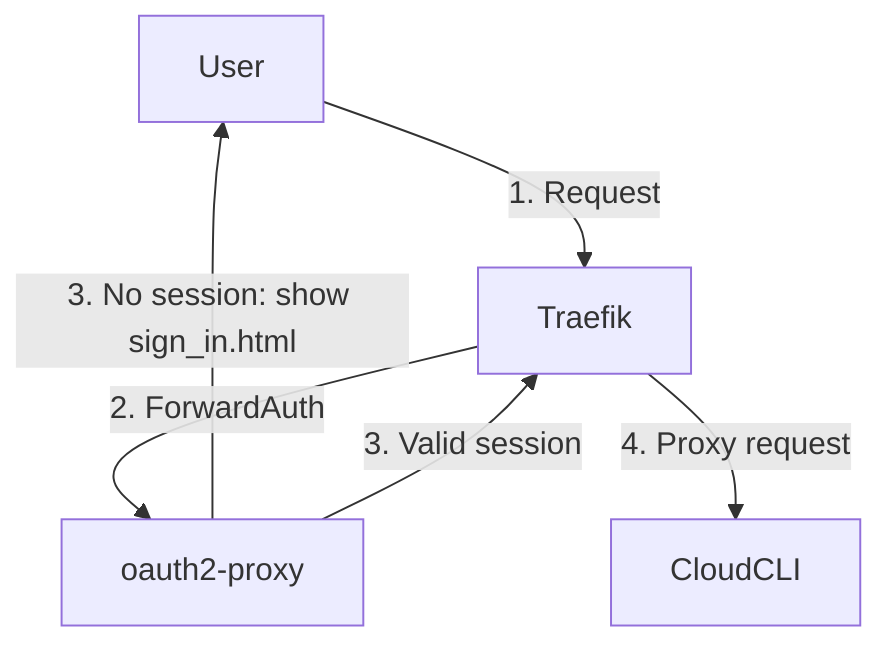

# claude-code-ui compose stack

Traefik (TLS + reverse proxy) and oauth2-proxy (username/password login) in
front of [CloudCLI](https://cloudcli.ai), the npm package for
[siteboon/claudecodeui](https://github.com/siteboon/claudecodeui).

CloudCLI runs on the host (via `start.sh` or a systemd user service), not in a
container. Docker
Compose only runs Traefik, oauth2-proxy, a `whoami` test route, and a one-shot
init container that creates CloudCLI's first user.

## Request flow



Traefik forwards every request to oauth2-proxy for a ForwardAuth check. Without
a valid session, oauth2-proxy serves `sign_in.html` for htpasswd credentials;
once authenticated, Traefik proxies the request on to CloudCLI.

## Layout

- `docker-compose.yml` — Traefik, oauth2-proxy, whoami, cloudcli-init.
- `start.sh` / `stop.sh` / `restart.sh` / `status.sh` / `logs.sh` — manage
  CloudCLI and the compose services, see [Running](#running).
- `install-cloudcli-service.sh` — install CloudCLI as a systemd user service (start on boot).
- `lib.sh` — shared helpers for the scripts above.
- `sign_in.html` — oauth2-proxy's sign-in page (username/password only).
- `.htpasswd` — basic-auth credentials for oauth2-proxy. Gitignored.
- `.env` — config and credentials, copied from `.env.example`. Gitignored.
- `data/` — CloudCLI's SQLite DB, pid file, and log. Gitignored.

## Env vars

Copy `.env.example` to `.env` and fill in:

| Var | Purpose |
|---|---|
| `LE_ACCOUNT_EMAIL` | Let's Encrypt account email |
| `SERVER_FQDN` | Public hostname of this host |
| `CLOUDCLI_DATA_DIR` | Host dir for CloudCLI's DB/pid/log |
| `CLOUDCLI_PORT` | Optional, default `3010`. Must match `docker-compose.yml` |
| `CLOUDCLI_INIT_USERNAME` / `CLOUDCLI_INIT_PASSWORD` | CloudCLI's first user |
| `*_VERSION` | Pinned image/binary versions |
| `CLOUDCLI_ENV_FILE` | Optional, default `~/.config/cloudcli/.env`, see below |

### Extra env for CloudCLI

CloudCLI doesn't see the variables in your `~/.bashrc` (systemd never reads
it), so it and everything it spawns (`claude` sessions, terminals, tools)
start without them: provider settings, API keys, tokens. Put any you need in
`~/.config/cloudcli/.env` (`chmod 600`), one `KEY=value` per line with no
`export`. Use double quotes for values with spaces. For example, the Claude API:

```
ANTHROPIC_API_KEY=sk-ant-...
ANTHROPIC_BASE_URL=https://api.anthropic.com
ANTHROPIC_CUSTOM_HEADERS="x-example-header: value"
```

The systemd service and `start.sh` both load the file. If it's missing,
CloudCLI starts anyway, just without these variables. After you edit it, run
`./restart.sh cloudcli`; you don't need to re-run the installer. To use the same
file in your shell, add this to `~/.bashrc`:
`set -a; . ~/.config/cloudcli/.env; set +a`.

## Running

Every script takes optional service names and acts on all services when none
are given. `-h` / `--help` shows the options of each.

| Command | What it does |
|---|---|
| `./start.sh [service...]` | Start what isn't running. Never restarts anything. |
| `./stop.sh [-y] [service...]` | Stop. With no names: everything, and `docker compose down`. |
| `./restart.sh [-y] [service...]` | Restart. Containers are recreated, so `.env` / `docker-compose.yml` changes apply. |
| `./status.sh [-v] [service...]` | Health checks with a hint for every failure; non-zero exit if any check fails. |
| `./logs.sh [-n N] [--no-follow] [service...]` | Last N lines (default 100), then follow. |

Services: `cloudcli`, `traefik`, `oauth2-proxy`, `whoami`. Groups: `all` (the
default) and `proxy` (`traefik oauth2-proxy whoami`).

```
./start.sh                  # bring up whatever is down
./restart.sh oauth2-proxy   # e.g. after editing .htpasswd
./stop.sh proxy             # stop the containers, keep CloudCLI running
./status.sh cloudcli        # just CloudCLI and its boot service
./logs.sh                   # everything, merged, one prefix per service
```

Things to know:

- **Stopping or restarting CloudCLI drops all live terminal sessions**, so
  `stop.sh` / `restart.sh` ask first whenever it's included (also by default).
  `-y` skips the question; without a terminal to ask on, `-y` is required. Run
  from a CloudCLI terminal, `restart.sh cloudcli` hands the restart to a
  process that outlives the terminal, then the terminal disconnects.
- **Dependencies:** `start.sh traefik` also starts oauth2-proxy (Traefik waits
  for it to be healthy). `stop.sh oauth2-proxy` warns that every request fails
  its login check until it's back.
- **cloudcli-init** (registers CloudCLI's first user) runs whenever `start.sh`
  or `restart.sh` starts CloudCLI. It's harmless when the user already exists.
- CloudCLI is controlled through `systemctl --user` when the [boot
  service](#start-on-boot) is installed, otherwise as a background process
  using the pid file. `start.sh` uses the `cloudcli` binary if it's on `PATH`,
  otherwise `npx -y @cloudcli-ai/cloudcli`.

## Status

`status.sh` checks the CloudCLI process (pid file, port, `/health`), the boot
service and linger, each Docker Compose service (state, health, `cloudcli-init`
exit code), and, when `traefik` is included, the public endpoint through
Traefik (`/oauth2/sign_in`, pinned to 127.0.0.1). An untrusted TLS certificate
is a warning, not a failure. The CloudCLI log tail is printed automatically
when a CloudCLI check fails.

## Logs

- **CloudCLI** runs on the host, so its output (including its plugin servers)
  goes to `cloudcli.log` in `CLOUDCLI_DATA_DIR`, not to Docker or journald. It
  is appended to across restarts. When it's over 10 MB at start-up, it is moved
  to `cloudcli.log.1` (one old copy is kept). The lines have no timestamps.
- **Containers** log to Docker (`docker compose logs`).

`./logs.sh cloudcli-init` shows the first-user registration job's output.

## Start on boot

The Docker Compose services already restart on boot (`restart: unless-stopped`).
To do the same for CloudCLI, install it as a systemd user service:

```
./install-cloudcli-service.sh            # write, enable and start cloudcli.service
./install-cloudcli-service.sh --restart  # also switch a running CloudCLI over now (asks first)
```

The script writes `~/.config/systemd/user/cloudcli.service` with the absolute
`cloudcli` path and the current `PATH` baked in (systemd doesn't load nvm), and
enables linger so the service starts at boot without a login. If that fails, run
`sudo loginctl enable-linger $USER` once. Re-run the script after upgrading
node/nvm or changing `.env`.

The service is restarted if it crashes, and writes the same pid file and log as
a CloudCLI started by `start.sh`, so all scripts work the same either way. A
CloudCLI already started by `start.sh` is left alone; the service takes over on
the next boot, or run `./restart.sh cloudcli` to switch now. To stop starting
on boot: `systemctl --user disable cloudcli`.

## Before exposing publicly

- Change `CLOUDCLI_INIT_PASSWORD` in `.env`.
- Replace `.htpasswd` with your own user(s): `htpasswd -c .htpasswd <user>`.

## Avoiding double login

The `build-cloudcli/` directory contains a custom Dockerfile that compiles
claudecodeui with `VITE_IS_PLATFORM=true` at build time. This embeds
platform-mode configuration into the bundle, skipping CloudCLI's auth flow
entirely — users authenticate once via oauth2-proxy and proceed directly to
the app.
